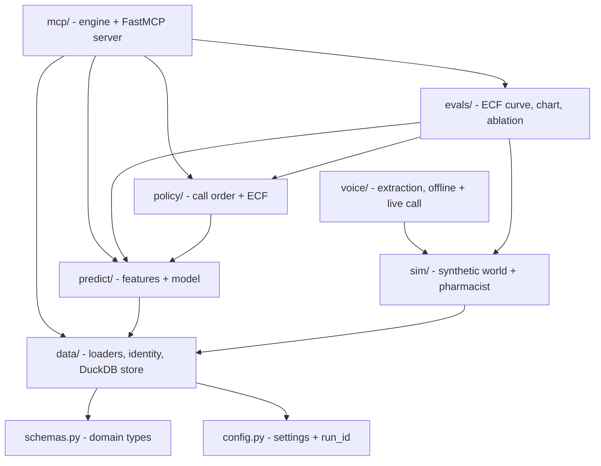
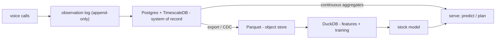
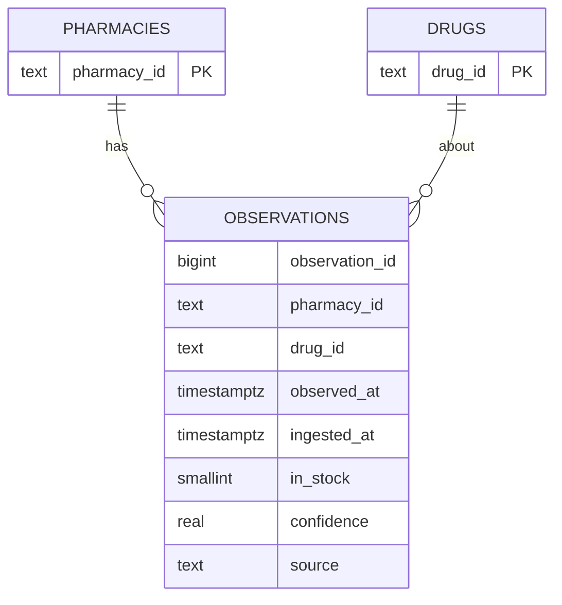
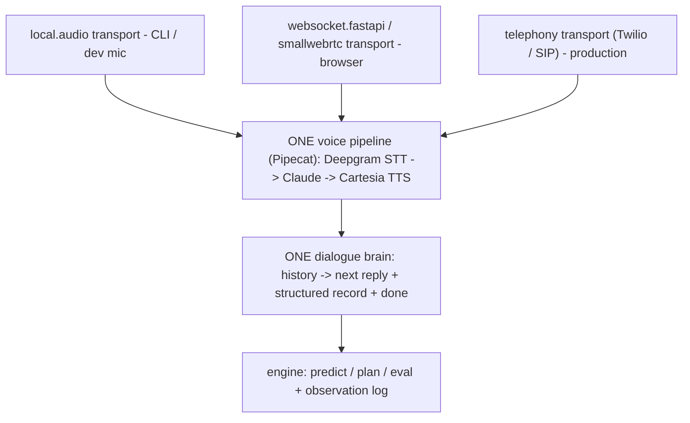

# CallBudget - Architecture & Decisions

The high-level, deliberately-recorded decisions. `FOUNDATION.md` is the binding
thesis; `BUILDLOG.md` is the build narrative; this file is the *why* behind
the structure and the plan for scale. Diagrams are Mermaid (renders on GitHub).

## 0. The integrity boundary (the decision everything else serves)

- **Real:** which pharmacies exist (NPPES), drug identity (RxNorm), throughput
  *priors* (real amphetamine dispensing volume - see §4), shortage windows (FDA/ASHP).
- **Synthetic:** the per-call in-stock *outcomes*. No public source has per-store
  real-time stock; manufacturing it is the product's premise. This never changes.
- Better data and a real database strengthen the **foundation and the signal**;
  they do **not** make the synthetic outcomes real. We say so everywhere.

## 1. Module architecture

Modules depend toward the stable core; outer surfaces are swappable.



## 2. Diagram tooling decision: Mermaid (not the Excalidraw MCP)

Mermaid renders natively in GitHub markdown, is plain text (diffs cleanly), and
needs no server. The Excalidraw MCP produces a live in-chat canvas / `.excalidraw`
JSON that does **not** render in a README and adds a standing local service. For
repo architecture docs, Mermaid wins. If we ever want the hand-drawn aesthetic for
a slide, the path is the Excalidraw web app, export SVG, then commit; not the MCP.

## 3. Data architecture: the observation log is the moat

The core asset is an **append-only, time-stamped, store-level observation log**.
It must be durable and replayable (you cannot reconstruct a time-series moat you
never persisted), and it splits cleanly into an OLTP serving path and an OLAP
training path.



**Now (this repo):** no server. The log is a DuckDB table mirrored to **Parquet**
(`data/store.py`); features are **windowed SQL** over it. `tests/test_store.py`
proves the SQL features equal the reference Python (`predict/features.py`) exactly.
This kills the "moat lives in RAM" smell and is a literal subset of the scaled path.

**At scale (production):** Postgres + TimescaleDB as the system of record
(hypertables auto-partition by time; continuous aggregates serve `recent_hit_rate`
cheaply); the log exports to partitioned Parquet for DuckDB-driven training.
ClickHouse only past ~100M observations/day. The OLTP/OLAP split is the shape.

## 4. Data sources decision

| Signal | Now (v1) | Real upgrade (identified, planned) |
|---|---|---|
| Pharmacies | NPPES (real) | unchanged |
| Drug identity | RxNorm RxCUI 861226 (real) | unchanged |
| Throughput prior | ARCOS-*shaped* (opioid-calibrated) | **Part D by Geography & Drug** (amphetamine, state) + **Medicaid SDUD** (NDC, state x quarter) + **ARCOS Retail Summary** (amphetamine, ZIP-3) |
| Shortage window | **openFDA (real, fetched + cached)** | done (live onset + status) |
| In-stock outcomes | **synthetic** | **stays synthetic** (does not exist) |

The upgrade replaces a wrong-drug proxy with real, drug-correct, geographically
resolved priors. All real sources top out at state/ZIP, never per-store, so the
synthetic-outcome boundary is unchanged.

## 5. The star schema (scale target)



Append-only, never UPDATE (a stock change is a new row). Two timestamps:
`observed_at` (event time, drives freshness/decay) vs `ingested_at` (processing
time, for replay correctness). `in_stock` is a smallint with an explicit unknown,
not a nullable bool ("they didn't know" is signal). The serving-side
`recent_hit_rate` maps onto a TimescaleDB continuous aggregate.

The windowed feature that powers the flywheel (today in DuckDB, tomorrow a
continuous aggregate), in spirit:

```sql
avg(CASE WHEN in_stock = 'yes' THEN 1.0 ELSE 0.0 END)
  OVER (PARTITION BY pharmacy_id, drug_id ORDER BY observed_at
        ROWS BETWEEN UNBOUNDED PRECEDING AND 1 PRECEDING)   -- strictly prior
```

## 6. Decision log

- **DuckDB + Parquet now; Postgres + TimescaleDB + Parquet/DuckDB at scale.** The
  log is the moat and must be durable; the demo uses the lightest structurally-
  correct option, which is the data-eng signal (restraint, not ceremony).
- **sklearn HistGradientBoosting, not xgboost** (no macOS OpenMP system dep; native NaN).
- **Mermaid for diagrams**, not the Excalidraw MCP.
- **fastmcp in core deps** (the MCP surface is a deliverable, not voice-only).
- **Web UI:** FastAPI + a static page over the engine (`callbudget serve`).
  **MCP usage docs:** `docs/mcp-usage.md` (tools + example prompts).
- A DB does not make outcomes real. Foundation and signal, not evidence.

## 7. Production layers: documented, not built

Two layers are deliberately specified here without being implemented, so the
scope stays honest and the path is legible.

- **Live telephony.** The voice loop is offline (`voice/loop.py`) with a local
  Pipecat path (`voice/live_call.py`); the missing piece is a real phone
  transport (Twilio / a SIP carrier into a Pipecat phone pipeline) that places
  outbound calls to real numbers. That is a deployment + compliance + PHI concern,
  not a modelling one, so it is named and left out.
- **OLTP/OLAP at scale.** The Postgres + TimescaleDB system of record, continuous
  aggregates, and partitioned-Parquet export (sections 3 and 5) are the documented
  scaling target. The repo runs the structurally-correct subset (DuckDB + Parquet),
  not the server stack.

Both are recorded as design, not as claims of running infrastructure.

## 8. Scale: geography as a feature, and the freshness treadmill

Stock patterns are city / state / chain specific, which tempts a model per
geography. That is the wrong cut. Per-region models fragment the data, starve
low-volume regions, and multiply the train / serve / monitor surface. The
sustainable design is ONE pooled model with geography as features (region, ZIP,
urban vs rural, chain, local shortage state); the gradient-boosted trees learn the
local interactions, and partial pooling covers regions that genuinely deviate.
Pooling makes the flywheel stronger, not weaker: more data sharpens predictions
everywhere instead of splintering into many thin models.

What scales, and what costs:

- The log is standard time-series infrastructure (section 3): append-only,
  time-partitioned hypertables, space-partitioned by region, exported to Parquet
  for training. National volume is well-trodden ground.
- Inference and storage are cheap; the dominant marginal cost is CALLING (real
  telephony, money and time per call). Because the objective minimizes
  calls-to-find, the prediction layer directly controls that cost: better
  predictions mean fewer calls per result, so unit economics improve with scale.
  The moat makes the product cheaper to run as it grows.
- The honest hard part is FRESHNESS. Stock answers decay in hours, so predictions
  go stale without fresh calls. The ongoing cost scales with coverage times the
  freshness requirement, divided by the calls saved by prediction. The flywheel
  offsets this but never removes it; a cold region must be re-acquired. The model
  is sustainable exactly when the ranker keeps calls-per-find low enough that
  maintaining freshness costs less than the value delivered.

The auto-research loop scales into a continuous pipeline: the synthetic seeds
become real geographic and temporal splits (train on some regions and weeks,
validate on held-out ones), shipping a new config only if it beats the incumbent
under the safety constraint. The constraint plus the held-out validation guard are
what make autonomous self-improvement safe to leave running: it structurally
cannot ship a fake or unsafe win.

Known limits at scale: low-data regions (handled by pooling and features, not
per-region models), the freshness treadmill (the real bottleneck), and correlated
regional outages that break the greedy policy's independence assumption (the
deferred bandit / correlation-aware variant, see `policy/budget.py`).

## 9. Target: one voice pipeline, transport adapters (the unification)

The engine is already ports-and-adapters: one core (`mcp/engine.py`) behind three
thin adapters (CLI, MCP server, web). The voice layer is the one place that has not
yet earned that discipline, and this section is the target it migrates to.

Status: Stage 1 is done. The dialogue brain now lives in one module
(`voice/dialogue.py`, `respond(history, drug, dose, caller) -> Turn`) and every
surface drives it: the CLI (`callbudget converse`), the web (`/api/converse`), the
MCP server (the `converse` tool), and the terminal voice loop (`live_call.py`). The
per-utterance terminal logic and the inlined web dialogue were removed, and the
vestigial `/api/extract` endpoint was deleted. One behavior everywhere, text in and
text out, unit-tested with no audio.

What remains (Stage 2) is the single provider divergence: the browser still uses the
Web Speech API for audio I/O instead of streaming to the Pipecat Deepgram/Cartesia
pipeline. That is the next step below.



Principles (the same ones the engine already follows):

- **One dialogue brain.** The conversation logic (open with the AI disclosure +
  recording consent, ask a clarifying question when unsure, confirm, close, and emit
  the structured `ExtractionRecord`) lives in a single module, text in and text out,
  so it is deterministically testable and identical on every surface.
- **One provider stack.** Deepgram (STT), Claude (dialogue + extraction), Cartesia
  (TTS), orchestrated by Pipecat, everywhere. No browser Web Speech.
- **Transport is the only thing that varies.** `local.audio` for the CLI/dev,
  `websocket.fastapi` (or `smallwebrtc`) for the browser, a telephony transport for
  production. The browser connects to the same backend pipeline; it does not run its
  own stack. Different transports are correct (a phone, a browser, and a terminal
  cannot share one), so quality is identical across surfaces and only the wire differs.
- **Same engine underneath.** The dialogue brain calls predict / plan / eval and
  appends to the observation log, exactly as the CLI / MCP / web adapters do.

What the target removes (today's cruft):

- the browser Web Speech path (replaced by the websocket transport into the pipeline),
- the `/api/extract` one-shot endpoint (the dialogue brain subsumes it),
- the second extractor (`make_instructor_extractor` vs `make_claude_extractor`: keep one),
- the per-utterance loop in `voice/live_call.py` (replaced by the shared brain).

Migration order, so each step is independently testable:

1. DONE. Promoted the dialogue logic to one module (`voice/dialogue.py`); pointed the
   CLI, the web, the MCP server, and the terminal at it; deleted the duplicate
   behavior and the vestigial `/api/extract` endpoint. Unit-tested, no audio.
2. Put the browser on the Pipecat pipeline via `websocket.fastapi` (Deepgram +
   Cartesia), delete Web Speech. Needs local audio verification.
3. Telephony transport stays documented (section 7), not built.

End state, one sentence: one dialogue brain and one Deepgram / Claude / Cartesia
pipeline, reached through local-audio, browser-websocket, and telephony transport
adapters, all over the one prediction engine.
