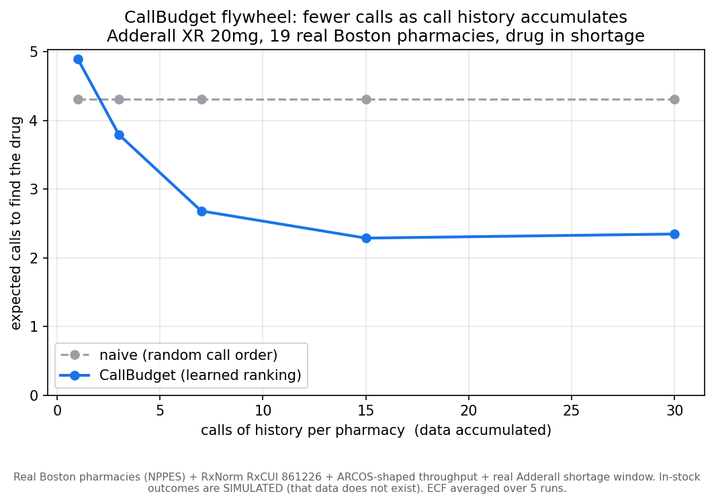
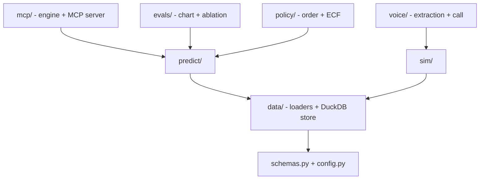

# CallBudget

**Finding a drug that is in shortage should not mean calling twenty pharmacies by
hand.** During the national Adderall shortage, a patient (or the clinic calling for
them) phones pharmacy after pharmacy, because no system can tell you which one has it
in stock right now. That rail was never built: e-prescribing carries prescriptions,
not shelf state, and inventory sits in siloed on-prem pharmacy systems.

CallBudget is the missing layer, framed as **active sensing under a calling budget**:
predict which pharmacy most likely has the drug, call the most-likely ones first, and
learn from every call. A voice agent does the calling and turns the messy spoken
answer into structured data, abstaining instead of guessing when unsure, because a
wrong "yes, in stock" sends a patient to an empty pharmacy. Every call sharpens the
next search: more calls, fewer calls-to-find. The calling is the commodity; the
labeled, decaying, store-level stock data is the moat.

> **Honest by construction.** Built on free + synthetic data, zero PHI. The
> scaffolding is real (which pharmacies exist, the drug identity, the shortage
> window); the per-call in-stock outcomes are simulated, because real-time
> shelf-stock data does not exist anywhere. That gap is the premise, not a shortcut.
> See "What is real vs synthetic" below.



*Reading the chart: on 19 real Boston pharmacies (a deduplicated NPPES subset) for
Adderall XR 20mg (in shortage), naive random calling takes ~4.3 calls to find the
drug; the learned ranker drops that toward ~2.3 as call history accumulates (about
47% fewer). The crossover at the left is the point: with no data there is no edge.
The data is the moat.*

## Quickstart

```bash
uv sync                       # Python 3.11 (fetched by uv) + core deps
uv run callbudget demo        # end-to-end walkthrough
uv run callbudget chart       # render figures/ecf_flywheel.png
uv run pytest -q              # the test suite
```

## The idea

There is no way to query "does this pharmacy have this drug in stock right now."
That data was never built into the pharmacy software rails, so today you call
pharmacies one by one. The calling is a commodity **wedge**; the **moat** is the
data exhaust: every call is a labeled, timestamped, store-level stock
observation, and that dataset is scarce (no one else can query shelf inventory)
and decays (a stock answer is good for hours), so a competitor cannot buy a dump
and catch up. CallBudget is the prediction layer that turns that exhaust into
fewer-calls-per-search. More calls -> sharper predictions -> fewer calls: the
flywheel.

## What is real vs synthetic (the integrity boundary)

- **Real:** which pharmacies exist (NPPES), the drug identity (RxNorm RxCUI
  861226), the Adderall shortage window (openFDA).
- **Synthetic:** the per-call in-stock *outcomes*, because real-time shelf-stock
  data is exactly what does not exist anywhere (that is the project's premise),
  and per-pharmacy throughput, drawn from a seeded lognormal chosen to resemble
  ARCOS distribution data (`load_arcos_throughput`; no ARCOS data is loaded).
- The chart demonstrates the *mechanism on realistic inputs*; it is not a claim
  about real Boston stock rates. ARCOS (opioids) is a same-DEA-schedule
  *throughput* proxy, never an Adderall-specific signal.

## Architecture

Modules depend toward the stable core; swappable surfaces sit on top.



See `ARCHITECTURE.md` for the data architecture (the observation log, OLTP/OLAP split, scaling plan).

| Package | Responsibility |
|---|---|
| `schemas.py` | shared domain types (the vocabulary every module speaks) |
| `data/` | loaders (NPPES, RxNorm, ARCOS shape, shortage), identity, DuckDB/Parquet observation store |
| `sim/` | the hidden-truth world + the simulated pharmacist |
| `predict/` | features + the stock-probability model (sklearn HistGradientBoosting) |
| `policy/` | call ordering + expected-calls-to-find (ECF) |
| `voice/` | extraction with calibrated abstention; offline + live (Pipecat) call paths |
| `evals/` | ECF curve, the chart, the reliability ablation |
| `mcp/` | `engine.py` (logic) + `server.py` (FastMCP adapter) |

## CLI

```
callbudget predict   rank pharmacies by P(in_stock)
callbudget plan      call order + expected calls-to-find
callbudget eval      ECF (naive vs learned) + safety metrics
callbudget demo      end-to-end walkthrough
callbudget chart     render the ECF flywheel chart
callbudget research  auto-search configs against ECF under a safety constraint
callbudget serve     run the web UI (needs: uv sync --extra web)
```

## Web UI

A small FastAPI app serves a single page over the same engine (another adapter,
like the MCP server). One command, no build step:

```bash
uv sync --extra web
uv run callbudget serve          # http://127.0.0.1:8000
```

It shows the ranked pharmacies, the call plan, a two-way voice conversation (push to
talk: your mic is transcribed by Deepgram, the agent replies in Cartesia's voice,
with a typed fallback), the safety metrics, the chart, and the auto-research
leaderboard. The voice needs Deepgram + Cartesia keys in `.env`; without them the
conversation still works by typing.

### Public demo (typed-only, zero-cost, offline)

The repo ships a container that runs the showcase with **no API keys at all**: the
engine seeds its synthetic world deterministically from the committed Boston
scaffolding, the conversation runs the offline dialogue brain, and the mic + spoken
replies are turned off (`CALLBUDGET_VOICE=0`), so no paid speech API is ever called.
That is the build behind the live link, and it cannot run up a bill.

```bash
fly launch --no-deploy --copy-config --name callbudget-demo   # first time: create the app
fly deploy                                                    # build (remote builder) + ship
```

It scales to zero when idle, so it costs ~nothing at rest; a request cold-starts a
machine and re-seeds the engine in a few seconds.

## MCP server

CallBudget exposes its engine over MCP (`predict_stock` / `plan_calls` / `run_eval` /
`converse`) so an agent can call it as a tool: rank pharmacies, plan the cheapest call
order, check whether it beats random, and actually hold the stock call with calibrated
abstention. See `docs/mcp-usage.md` for the tools, example prompts, and **a real
reproducible transcript of what the agent sees**. Run it with
`uv run python -m callbudget.mcp.server`.

## Configuration (env)

- `OPENFDA_API_KEY` (optional): raises the openFDA rate limit when fetching the real shortage window.
- `CALLBUDGET_OFFLINE=1`: skip the network and use the committed caches + documented fallbacks.

## Safety: abstention over guessing

A wrong "in stock" sends a patient to an empty pharmacy, so the headline metric
is **false-positive-in-stock** (`P(said yes | truth no)`), not raw accuracy. The
extractor abstains on ambiguity and on self-consistency disagreement. In the
reliability ablation, under a deliberately unreliable extractor (25% misread),
self-consistency drives false-positive-in-stock from 10.2% to 0%, trading
coverage (more re-calls) for safety. See `uv run callbudget eval` and
`scripts/reliability_ablation.py` (19 pharmacies x 20 trials, 380 calls):

| Samples | False "in stock" | Abstained | Decided accuracy |
|---------|------------------|-----------|------------------|
| 1 | 10.2% | 26.6% | 78.1% |
| 3 | 0.0% | 69.2% | 100% |
| 5 | 0.0% | 51.3% | 99.5% |

Five samples keep the false-positive rate at zero while abstaining on far fewer
calls than three. Voting runs in the extractor and the evals; the live Pipecat
call currently abstains only when the answer comes back unknown.

## Auto-research loop

The same integrity discipline, turned on the project's own tuning. An agent
searches the model hyperparameters (`max_depth` / `max_iter` / `learning_rate`)
and the voice self-consistency knobs (`n_samples` / `abstain_threshold`). The
fitness function is the **existing closed-loop eval**: a real
call -> extract -> abstain -> label -> retrain cycle run under a deliberately
unreliable extractor (25% misread), so extraction quality flows into
expected-calls-to-find (ECF). The false-positive-in-stock safety metric is a
**hard constraint**, not a co-objective: the lowest-ECF config is often the one
that abstains least and is therefore the least safe, so the constraint is what
keeps the search from picking it. Optuna (a seeded TPE sampler with a
constraints function) drives the search; every trial is journaled to
`runs/research_journal.jsonl`, and a Rich leaderboard plus `runs/research_report.md`
summarise it.

```bash
uv run callbudget research
```

**The honest result, and why the guards are the deliverable.** On this synthetic
problem the loop's in-sample ECF gain (9.8%: 2.86 vs 3.17) does **not** survive held-out
validation: the loop optimises on a set of search seeds and re-scores the winner
on a disjoint set of validation seeds, and there the winner's advantage falls
inside world-to-world noise. So the loop **recommends keeping the v1 defaults**.
That is the point. The deliverable is not a headline ECF win; it is (1) the
**safety constraint**, which rejected 3 of 14 trials for breaching the
false-positive bar, and (2) the **validation guard**, which refuses to ship an overfit in-sample gain.
This is the same honesty boundary as the rest of the project applied to the
research process itself: outcomes are synthetic, so the loop proves the **search
mechanism** on realistic inputs, never a real stock-rate gain.

## Libraries (reused, not hand-rolled)

- **Rich** for terminal presentation, so the leaderboard is not a hand-rolled table printer.
- **Optuna** for the constrained search (seeded TPE + a constraints function), so the sampler and constraint plumbing are not hand-rolled.
- **Hypothesis** for property-tested ECF invariants, so edge cases are generated rather than hand-enumerated.
- **mcp-use** for a live agent that drives the MCP surface (behind `uv sync --extra agent`), so the agent loop is not hand-rolled.
- **instructor** for schema-validated LLM extraction (same `--extra agent`), so parsing/validation is not hand-rolled.
- Deliberate **non-use**: Weights & Biases / MLflow (heavyweight for this scope; a JSONL journal plus Optuna's own study suffice) and xgboost / lightgbm (system dependencies; sklearn HistGradientBoosting was chosen instead).

## The voice layer

One dialogue brain (`voice/dialogue.py`) drives every surface; only the transport differs.

- **The brain (tested):** `voice/dialogue.respond` turns the call-so-far into the
  agent's next line plus the structured record, text in and text out. Deterministic
  offline path (no key) in CI; live Claude path when keyed.
- **Browser (turn-based):** the showcase records a turn to `/api/stt` (Deepgram) and
  plays the reply from `/api/tts` (Cartesia). No build step; needs the keys in `.env`.
- **Terminal / production (streaming):** `voice/live_call.py` is the real Pipecat
  pipeline (Deepgram -> the brain -> Cartesia). Needs `uv sync --extra voice` + keys +
  a mic; not exercised in CI. Telephony is the same pipeline with a Twilio/SIP transport.

## Learn more

- `BUILDLOG.md` - the high-level narrative of how the system is built.
- `ARCHITECTURE.md` - module + data architecture, decisions, and the scaling plan (Mermaid diagrams).
- `FOUNDATION.md` / `SPEC.md` - the binding thesis, metrics, and locked decisions.
- `docs/mcp-usage.md` - the MCP tools, use cases, and example prompts.

## License

Apache-2.0. Built on 100% free / synthetic data, zero PHI.
